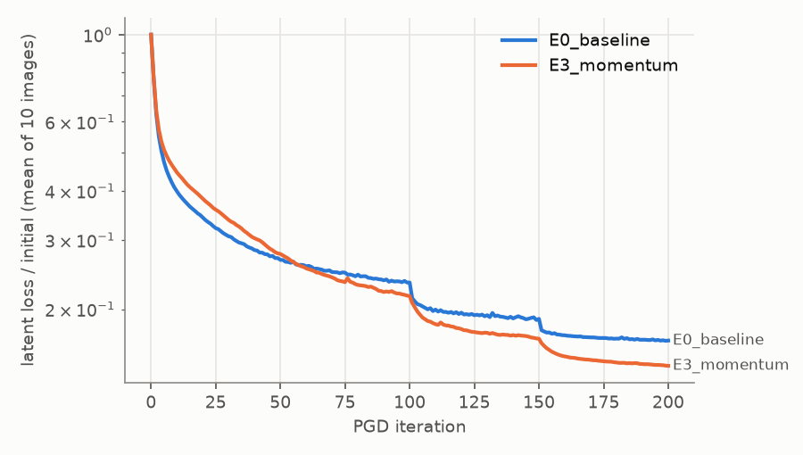
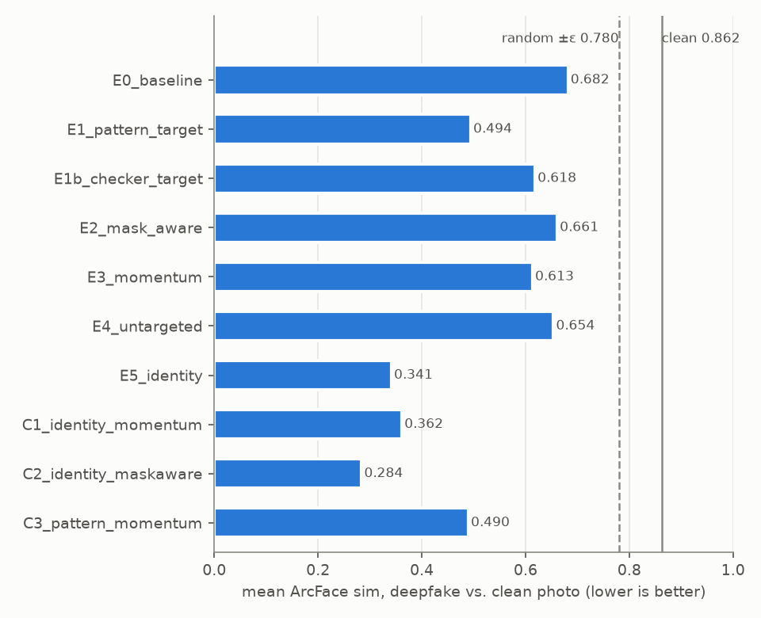

# Face cloaks against inpainting deepfakes: progress report

*CRP II. Generated by `scripts/make_report.py` from `runs/`; do not edit by hand. Covers the earlier Colab work (shared-folder snapshot) and the runs on VISHC Server 2.*

## 1. The idea in brief

An attacker takes a public photo, keeps the person's face and has **Stable Diffusion 1.5 inpainting** generate a
new scene around it, for example a park, a police station or a nightclub. We want a **cloak**: a small change δ to
the photo, with every pixel moved by at most ε = 16/255, applied *before* the photo is posted. After the attacker's
edit, the face should no longer be recognised as the same person.

```
photo ─► cloak (PGD on the SD VAE encoder) ─► posted photo ─► attacker: SD 1.5 inpainting
         keeps the face (MediaPipe face oval), new background ─► deepfake ─► ArcFace: same person?
```

- **Metric:** `sim` is the ArcFace cosine similarity between the face in the deepfake and the clean photo. Lower is
  better.
- **Protected:** a deepfake counts as protected if no face is found or `sim < τ`.
- **Controls:** we always compare with the deepfake of the **clean** photo and with **random ±ε noise** of the same
  budget. A cloak is only interesting if it beats random noise. The paired Δ compares the same image, prompt and
  seed.
- **Pipeline property** (`docs/pipeline.md`): the attacker's VAE only sees the face on mid-gray, and the face in
  the output is VAE-decoded rather than pasted back. So perturbing the VAE changes the face the attacker gets.

## 2. Starting point: what was done before (Colab, team shared folder)

Archived in `results/baseline_pgd_gray/` (notebooks in `notebooks/legacy/`). Notes in `docs/baseline_results.md`.

- **Motivation.** Reproduce PhotoGuard's encoder attack (Salman et al., 2023) on an inpainting deepfake and check
  whether it protects identity, not just image quality.
- **Method.**
  - **Cloak:** PGD pulls the VAE latent of the photo toward the latent of a flat gray image, with the loss on the
    full image.
  - **Attack and evaluation:** SD 1.5 inpainting keeps the MediaPipe face oval. UniFace measure the similarity.
  - **Scale:** 2 images × 3 prompts × 3 seeds
    = 54 edits, on a Colab T4.
- **Result.**

  | branch | mean sim | paired Δ vs clean |
  |---|---|---|
  | clean | 0.843 | — |
  | random ±16/255 | 0.767 | +0.077 |
  | cloak | 0.696 | +0.135 |

  The cloak lowered similarity, but beat random noise by only +0.052.
- **Why these were not usable as reference numbers:**
  - The ε=16 cloaks ran only 50 PGD iterations (a quick test).
  - Only 2 images were evaluated.
  - τ was estimated from a single impostor pair (-0.018, meaningless).
  - 4 of 54 outputs were blacked out by the safety checker, most of
    them cloaks.
- **Code before this work:** the notebooks had been restructured into the `facecloak` package (configs, scripts,
  tests), but nothing had been run with it yet.

## 3. What I did on VISHC Server 2

### 3.1 Infrastructure and a fixed protocol

- **Motivation.** Get reference numbers that are reproducible and comparable with teammates' Colab runs, and that
  have a meaningful threshold.
- **Method.**
  - **Environment:** a conda env on `/mnt`, model caches off `/home`, and Slurm scripts in `slurm/`: one GPU per
    run, sweeps as arrays limited to 2 GPUs at a time.
  - **Fixed protocol:** 10 FFHQ dev images, prompt 0 ("park"), seeds {0, 1}, giving
    20 edits per branch. Every experiment changes one setting relative to the baseline.
  - **Fixed τ:** calibrated once from 300 held-out FFHQ faces (44850 impostor
    pairs, false-accept rate 1%). It is stored in `configs/base.yaml`, so every git clone uses the
    same value.
  - **No shared Drive:** outputs go to `runs/` on every machine. Teammates clone the repo on Colab.
  - **Download fix:** Kaggle downloads occasionally hung forever, so they now time out and retry.
- **Result.**
  - τ = **0.149**. This is lower than the 0.3–0.4 often quoted for ArcFace, but those values correspond to
    a much stricter false-accept rate. At 1%, 0.149 is the expected value.
  - A cloak takes about 17 s per image for latent losses and about 60
    s per image for the identity loss.

### 3.2 E0: the baseline, re-run properly

- **Motivation.** Get a reference that every other method is compared with.
- **Method.** PhotoGuard as before: gray target, full-image loss, 200 PGD iterations, step size halved twice,
  random start.
- **Result.**
  - Mean sim **0.682**, against 0.862 for clean and 0.780 for random.
  - Δ vs random: +0.090 [+0.059, +0.120]. The cloak's advantage over plain noise is small.
  - Protection: 0%.
  - Safety-checker flags: 25% of cloak outputs. The washed-out gray faces are often flagged
    as NSFW.
  - Sanity check: the VAE reconstruction of the cloaked photo collapses to a gray blur, so the attack does what it
    is designed to do. The identity still survives the attacker's diffusion model.

### 3.3 E1 / E1b: a different target image

- **Motivation.** A gray target only blurs the face, and the diffusion model then re-synthesises a plausible face
  of the same person. A structured target might break the face itself.
- **Method.** Pull the latent toward a dense colour pattern (E1) or a plain 8-px checkerboard (E1b, an ablation)
  instead of gray.
- **Result.**
  - E1: **0.494**, Δ vs random +0.284 [+0.239, +0.329]. This is the best latent
    target.
  - E1b: 0.618.
  - The colour pattern leaves textured artefacts across the face instead of a blur.

### 3.4 E2: optimise what the attacker actually sees

- **Motivation.** The attacker's VAE only sees the face on mid-gray, so a cloak optimised on the full photo wastes
  budget on the background.
- **Method.**
  - Compute the loss on `face·m + 0.5·(1−m)`, the attacker's view of the photo.
  - Randomly grow or shrink the mask by up to 10 px each step, so the cloak does not depend on one exact mask.
- **Result.**
  - Mean sim 0.661, only slightly better than E0. The objective is still the weak gray target.
  - The latent distance is lower (latent dist 8.5 vs 17.9) because only
    the face region is optimised.

### 3.5 E3: momentum PGD

- **Motivation.** Check whether the optimiser, rather than the objective, is the bottleneck.
- **Method.** MI-FGSM (Dong et al., 2018) with momentum 0.9.
- **Result.**
  - Mean sim 0.613, a modest gain.
  - Momentum starts more slowly but ends at a lower latent loss (figure below).



### 3.6 E4: untargeted

- **Motivation.** Instead of choosing a target, push the latent as far from the photo's own latent as possible.
- **Method.** Maximise ‖E(x+δ) − E(x)‖².
- **Result.**
  - The latent distance is by far the largest (65.3, against 17.9 for E0),
    yet mean sim is only 0.654.
  - Distance in latent space is a poor proxy for identity.

### 3.7 E5: optimise identity directly (new)

- **Motivation.** E1–E4 all optimise a latent proxy. We should attack identity itself, but without cheating by
  optimising against the evaluator.
- **Method.**
  - Minimise the cosine similarity between the face after the VAE round trip, crop(D(E(x+δ))), and the clean face.
  - Use **FaceNet** (VGGFace2), a recognizer *different* from the ArcFace evaluator, so a good result shows transfer.
  - Code: `src/facecloak/identity.py`.
- **Result.**
  - Mean sim **0.341**, half of E0. Δ vs random: +0.445 [+0.399, +0.491].
  - The FaceNet cosine goes from 0.995 to -0.998, so the surrogate
    is completely fooled. Much of that transfers to ArcFace, but not all of it.
  - About 3–4× slower than the latent attacks, because gradients go through the VAE decoder.

### 3.8 Combinations of the winners

- **Motivation.** Check whether the best single changes add up.
- **Method.**
  - C1 = E5 + momentum.
  - C2 = E5 + the attacker's view with mask jitter.
  - C3 = E1 pattern + momentum.
- **Result.**
  - **C2 is the best configuration: 0.284**, Δ vs random
    +0.504 [+0.447, +0.556].
  - C2 is the only method with non-zero protection at the strict τ (12%).
  - Momentum adds nothing on top of E5 (C1, 0.362) or E1 (C3,
    0.490).

Example edits, showing the clean, cloaked and random inputs after the attack:

[grid:C2_identity_maskaware — figure with FFHQ faces, not committed; generate it with `python scripts/make_report.py`](../runs/report/figures/grid_C2_identity_maskaware.png) · [grid:E0_baseline — figure with FFHQ faces, not committed; generate it with `python scripts/make_report.py`](../runs/report/figures/grid_E0_baseline.png)

### 3.9 Robustness of E0, E5 and C2

- **Motivation.** Make sure the gains are not specific to one prompt, seed, mask or budget, and check a realistic
  upload: platforms recompress images as JPEG.
- **Method.** Keep the defender's cloak fixed and change one thing on the attacker's side:
  - prompts 1–2 (police station, nightclub)
  - seeds 0–3
  - a mask dilated by 10 px
  - ε = 8/255 (this one needs new cloaks)
  - JPEG quality 75 before the attack
- **Result.**
  - **Prompts and seeds:** the ranking holds. On prompts 1–2: C2 0.285, E5
    0.356, E0 0.673.
  - **Mask dilation:** the advantage is unchanged.
  - **Half the budget (ε = 8):** C2 still reaches 0.371 (PSNR 34.3 dB),
    far better than E0 at full budget.
  - **JPEG 75 is the weak point.** E0's advantage over random almost disappears (+0.035 [+0.014, +0.055]). C2
    rises to 0.501 and E5 to 0.498, still well below random noise.
  - **Run-to-run noise:** one E0 re-run gave 0.665 against 0.682.
    Differences of about 0.02 are within noise.

| run | n | clean sim | random sim | cloak sim ↓ | Δ vs clean ↑ | Δ vs random [95% CI] ↑ | protection ↑ | PSNR (dB) |
|---|---|---|---|---|---|---|---|---|
| R_C2_dilate10 (ε=16) | 18 | 0.914 | 0.841 | 0.339 | +0.571 | +0.502 [+0.456, +0.546] | 0% | 28.5 |
| R_C2_eps8 (ε=8) | 18 | 0.862 | 0.829 | 0.371 | +0.488 | +0.462 [+0.427, +0.498] | 0% | 34.3 |
| R_C2_eps8 (ε=16) | 17 | 0.862 | 0.780 | 0.284 | +0.575 | +0.504 [+0.448, +0.556] | 12% | 28.5 |
| R_C2_jpeg75 (ε=16) | 18 | 0.862 | 0.778 | 0.501 | +0.360 | +0.285 [+0.242, +0.331] | 0% | 28.5 |
| R_C2_prompts12 (ε=16) | 32 | 0.865 | 0.786 | 0.285 | +0.584 | +0.496 [+0.452, +0.537] | 16% | 28.5 |
| R_C2_seeds4 (ε=16) | 37 | 0.866 | 0.782 | 0.291 | +0.573 | +0.494 [+0.460, +0.529] | 8% | 28.5 |
| R_E0_dilate10 (ε=16) | 18 | 0.914 | 0.841 | 0.734 | +0.179 | +0.110 [+0.087, +0.135] | 0% | 26.5 |
| R_E0_eps8 (ε=8) | 16 | 0.862 | 0.829 | 0.744 | +0.114 | +0.079 [+0.050, +0.109] | 0% | 32.1 |
| R_E0_eps8 (ε=16) | 19 | 0.862 | 0.780 | 0.665 | +0.195 | +0.115 [+0.085, +0.144] | 0% | 26.5 |
| R_E0_jpeg75 (ε=16) | 14 | 0.862 | 0.778 | 0.738 | +0.116 | +0.035 [+0.014, +0.055] | 0% | 26.5 |
| R_E0_prompts12 (ε=16) | 28 | 0.865 | 0.786 | 0.673 | +0.188 | +0.113 [+0.081, +0.145] | 0% | 26.5 |
| R_E0_seeds4 (ε=16) | 30 | 0.866 | 0.782 | 0.679 | +0.183 | +0.107 [+0.082, +0.135] | 0% | 26.5 |
| R_E5_dilate10 (ε=16) | 18 | 0.914 | 0.841 | 0.379 | +0.531 | +0.464 [+0.420, +0.505] | 0% | 27.8 |
| R_E5_eps8 (ε=8) | 18 | 0.862 | 0.829 | 0.447 | +0.412 | +0.386 [+0.343, +0.432] | 0% | 33.1 |
| R_E5_eps8 (ε=16) | 17 | 0.862 | 0.780 | 0.341 | +0.515 | +0.445 [+0.399, +0.492] | 0% | 27.8 |
| R_E5_jpeg75 (ε=16) | 18 | 0.862 | 0.778 | 0.498 | +0.361 | +0.279 [+0.246, +0.314] | 0% | 27.8 |
| R_E5_prompts12 (ε=16) | 35 | 0.865 | 0.786 | 0.356 | +0.511 | +0.426 [+0.389, +0.461] | 0% | 27.9 |
| R_E5_seeds4 (ε=16) | 34 | 0.866 | 0.782 | 0.341 | +0.519 | +0.438 [+0.402, +0.475] | 0% | 27.8 |


## 4. Summary

| ID | Change | n | mean sim ↓ | Δ vs clean ↑ | Δ vs random [95% CI] ↑ | protection ↑ | NSFW | latent dist | PSNR (dB) | FaceNet cos (E5) |
|---|---|---|---|---|---|---|---|---|---|---|
| clean |  | 20 | 0.862 | — | — | 0% | 0% | — | — | — |
| random | ±16/255 sign noise | 19 | 0.780 | +0.081 | — | 0% | 5% | — | — | — |
| E0_baseline | PhotoGuard PGD, gray target (reference) | 15 | 0.682 | +0.174 | +0.090 [+0.059, +0.120] | 0% | 25% | 17.855 | 26.5 | — |
| E1_pattern_target | target = colour pattern | 18 | 0.494 | +0.365 | +0.284 [+0.239, +0.329] | 0% | 10% | 20.340 | 25.7 | — |
| E1b_checker_target | target = 8-px checkerboard | 15 | 0.618 | +0.237 | +0.147 [+0.116, +0.180] | 0% | 25% | 16.227 | 26.0 | — |
| E2_mask_aware | loss on attacker's view + mask jitter | 18 | 0.661 | +0.199 | +0.114 [+0.091, +0.137] | 0% | 10% | 8.530 | 28.1 | — |
| E3_momentum | momentum PGD (μ = 0.9) | 17 | 0.613 | +0.246 | +0.165 [+0.133, +0.195] | 0% | 15% | 19.036 | 25.6 | — |
| E4_untargeted | untargeted (push away from E(x)) | 20 | 0.654 | +0.209 | +0.130 [+0.104, +0.158] | 0% | 0% | 65.258 | 26.0 | — |
| E5_identity | identity loss (FaceNet) through the VAE | 17 | 0.341 | +0.515 | +0.445 [+0.399, +0.491] | 0% | 15% | 10.139 | 27.8 | -0.998 |
| C1_identity_momentum | E5 identity loss + E3 momentum PGD (μ = 0.9) | 18 | 0.362 | +0.501 | +0.428 [+0.383, +0.473] | 0% | 10% | 12.820 | 26.1 | -0.999 |
| C2_identity_maskaware | E5 identity loss + E2 attacker's view with ±10 px mask jitter | 17 | 0.284 | +0.575 | +0.504 [+0.447, +0.556] | 12% | 15% | 5.543 | 28.5 | -0.984 |
| C3_pattern_momentum | E1 pattern target + E3 momentum PGD (best latent-only pair) | 18 | 0.490 | +0.371 | +0.298 [+0.252, +0.342] | 0% | 10% | 21.262 | 25.2 | — |




- **Every cloak beats random noise**, but the PhotoGuard baseline only barely does (+0.090 [+0.059, +0.120]). Its
  gray target blurs the face, and the attacker's diffusion model restores the identity.
- **What matters most is what we optimise.**
  - Among latent targets, a structured target is better than gray: 0.494 vs
    0.682.
  - Optimising identity through the VAE with a different recognizer is better still: 0.341.
  - The optimiser (momentum, 0.613) and the untargeted objective (0.654) matter much less.
- **Best configuration: identity loss on the attacker's view (C2).** Mean sim 0.284,
  down from 0.862 without a cloak and 0.682 for the baseline. Protection at the
  strict τ is 12%.
- The gains hold across prompts, seeds, mask size and a halved budget. **JPEG recompression is the main weakness.**

## 5. Limitations

- **Small evaluation:** 10 images and one main prompt. Confidence intervals are wide, and
  differences of about 0.02 are within run-to-run noise.
- **One attacker** (SD 1.5 inpainting) **and one evaluator** (UniFace ArcFace R50). Other editors (SDXL, InstantID)
  and other recognizers are untested.
- **White-box assumptions:** the defender knows the attacker's VAE and that a face-oval mask is kept. Only the mask
  is jittered.
- **No adaptive attacker:** denoising, upscaling and diffusion purification are not tested. JPEG alone already
  weakens every cloak.
- **Strict τ:** at FAR 1%, almost no deepfake counts as "protected", so we mostly report similarity rather than a
  yes/no outcome.
- **NSFW exclusions:** up to a quarter of cloak outputs are blacked out by the safety checker and excluded, which
  changes n per method.
- **Cost:** the identity loss takes about 60 s per image on an A5000, about 3.5× the latent
  attacks.

## 6. Next steps

1. **JPEG-robust cloaks:** train through a differentiable JPEG (expectation over transformations, EOT) in the C2
   loss, then re-test at quality 75 and 90.
2. **Close the transfer gap:** optimise against an ensemble of recognizers (FaceNet + an IResNet/AdaFace model),
   and evaluate with a recognizer that none of them includes.
3. **Combine identity and texture:** `λ·latent(pattern target) + identity`, and more PGD iterations for C2.
4. **Scale up the evaluation:** more images (e.g. 50–100), all three prompts, and a second attacker (SDXL
   inpainting).
5. **Adaptive attacks:** JPEG at other qualities, resizing, denoising and diffusion purification of the upload.
6. **Report:** turn this report into slides, and settle with the team on whether protection should also be
   reported at a less strict τ.

## References

- Salman et al., *Raising the Cost of Malicious AI-Powered Image Editing* (PhotoGuard), ICML 2023.
- Madry et al., *Towards Deep Learning Models Resistant to Adversarial Attacks* (PGD), ICLR 2018.
- Dong et al., *Boosting Adversarial Attacks with Momentum* (MI-FGSM), CVPR 2018.
- Deng et al., *ArcFace*, CVPR 2019; Deng et al., *RetinaFace*, CVPR 2020; UniFace (yakhyo/uniface).
- Schroff et al., *FaceNet*, CVPR 2015; Cao et al., *VGGFace2*, FG 2018.
- Rombach et al., *High-Resolution Image Synthesis with Latent Diffusion Models*, CVPR 2022 (SD inpainting).
- Karras et al., *A Style-Based Generator Architecture for GANs* (FFHQ, CC BY-NC-SA 4.0); MediaPipe Face Landmarker.
